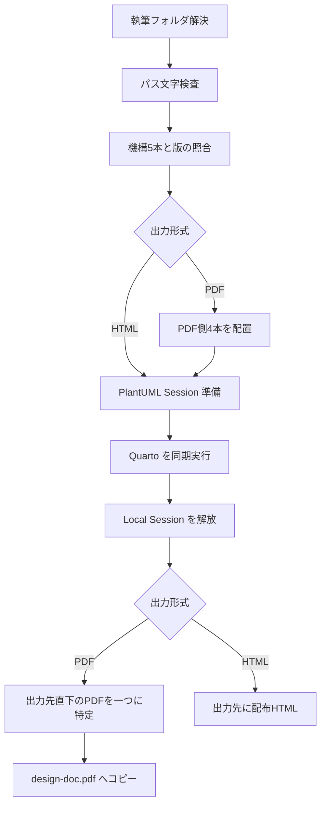
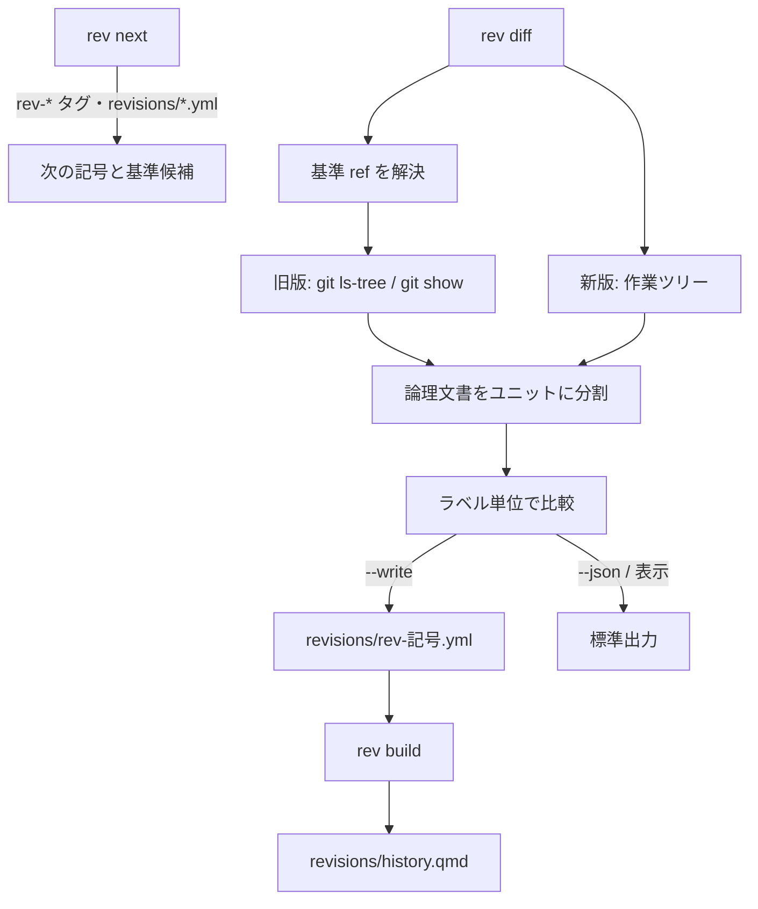

# 主要機能と処理の流れ {#sec-behavior}

## CLIの入口 {#sec-1e948b}

**確認済み（静的）**：公開コマンドは `init`、`add`、`update`、`setup`、`html`、`pdf`、`diagrams`、`plantuml serve`、`tag list／apply`、`rev next／diff／build`。内部用の `mermaid` は help から隠されるが直接呼べる。リリース一式の作成（旧 `release`）は 2026-11-23 から保守者用の別の exe `ddq-release` が行う（@sec-46f547）。`main.rs` の Args 定義が全引数の正本である。[E-0002](appendix-evidence.qmd#ev-e-0002)

| 用途 | 呼出形 | 既定・制約 |
|---|---|---|
| 新規作成 | `ddq init <repo> [name] [--no-render]` | name は `docs` |
| 文書追加 | `ddq add <folder> [--no-render]` | ancestor にリポジトリ目印が必要 |
| 機構更新 | `ddq update [folder]` または `ddq update --all <repo>` | folder と --all は排他 |
| 発行・準備・静的図 | `ddq setup/html/pdf/diagrams [folder]` | folder は CWD 基準の `docs` |
| 手動サーバ | `ddq plantuml serve [--port N] [--bind ADDRESS]` | `18080`、`127.0.0.1` |
| ラベル一覧 | `ddq tag list [folder] [--json] [--unlabeled]` | folder は CWD 基準の `docs` |
| ラベル付与 | `ddq tag apply [folder] --all [--dry-run]`、または `--all` に代えて `--from FILE` | --all と --from は排他。どちらも無ければエラー |
| 改訂の準備 | `ddq rev next [folder] [--json]` | 次の改訂記号と比較基準の候補 |
| 改訂の差分 | `ddq rev diff [folder] [--base REF] [--json] [--strict] [--write]` | base 既定は最後の `rev-*` タグ |
| 改訂履歴表 | `ddq rev build [folder] [--check]` | `--check` は警告で非成功 |
| 配布物（別の exe） | `ddq-release [out-dir] [--with-sample] [--no-build] [--ddq PATH]` | CWD はテンプレートのリポジトリルート。`--ddq` の既定は ddq-release と同じフォルダの `ddq.exe` |
| 内部変換 | `ddq mermaid -i <inputs...> -o <outputs...> [-c JSON] [-b COLOR]` | 入出力は同数、背景既定は transparent |
| 内部照会 | `ddq identity` | いまの環境（版・mermaid の見出し・フォントの指紋）を JSON で出す。フィルタが発行時に呼ぶ |

表の構文・既定値は静的確認済み。`setup/html/pdf/diagrams` は表を短くするための併記であり、一つずつ選ぶ。`tag apply` の「--all か --from のどちらか」は clap ではなく `main` の分岐で検査する。[E-0002](appendix-evidence.qmd#ev-e-0002)、[E-0020](appendix-evidence.qmd#ev-e-0020)

## 作成・更新・版の検査 {#sec-dda2e3}

**確認済み（静的）**：`init::run` はフォルダ名が空、または `/`・`\` を含む場合、または `.`／`..` の場合に拒否し、パス文字を検査する。repo直下の雛形（`.gitignore`・`.gitattributes`・`.vscode/settings.json`・`.vscode/extensions.json`・`README.md`。`extensions.json` は 3.0.0 で追加し、Quarto 公式拡張をおすすめに出す）は既存ファイルを保持し、README内の `{{CONTENT_DIR}}` を置換する。無いファイルは、同じフォルダの一時ファイルに書いてから上書きしない付け替えで置く（`replace::create_new`。3.1.0、IO-02）。同時に作られていれば付け替えが失敗し「既存のため skip」とする。2.3.0 以降の content 雛形は `revisions/history.qmd`（コメント1行）を含み、`index.qmd` がそれを include する。3.1.0 の content 雛形は1章が概要、2～7章が記法の見本（基本・文書の組み立て・表・図・横向きページとIPO図・相互参照）で、章・節のフォルダ名は番号だけ（`chapters/01` など）である。その後 `add::populate` を直接呼ぶ。`git init` は実行せず、次の操作として表示する。[E-0005](appendix-evidence.qmd#ev-e-0005)

**確認済み（静的）**：`add::run` は親から上に `.gitignore`、`.git`、`.svn`、`.hg` のいずれかを探し、追加先に `_quarto.yml` があれば拒否する。`populate` は content雛形の不足ファイルを作り、`update::run` で機構を上書きし、通常は `quarto render --to html` による疎通確認を行う。`--no-render` は最後の描画だけを省略する。init の再実行は原稿を保持するが、機構まで保持する操作ではない。[E-0005](appendix-evidence.qmd#ev-e-0005)

**確認済み（静的）**：`update::run` は機構5本を置き換えで書き（`assets::write_asset` → `replace::replace`）、書く前の `.template-version` と埋込み版が違う（版を上げる）場合は `diagrams/` 直下の `mmd-*`／`puml-*`（フィルタのキャッシュ）を消し、最後に `.template-version` を置き換える（3.1.0、IO-02）。キャッシュを消しきれない、または `diagrams` がフォルダでない・読めない・途中の項目を読めないときは、版マーカーを書かずに終了コード1で止まる（版マーカーは前の版のまま。`diagrams/` が無いときだけ消すものが無いとして進む。M-03）。再実行すれば版が変わる update としてキャッシュの削除からやり直す。同じ版での再実行では消さない。`--all` は指定先配下の `_quarto.yml` を探し、パス順に更新する。`_book`、`.quarto`、`node_modules`、`.git`、`target` は探索しないが、ddq専用の設定かどうかは判別しない。[E-0004](appendix-evidence.qmd#ev-e-0004)、[E-0006](appendix-evidence.qmd#ev-e-0006)

**確認済み（静的・限定実行）**：`setup::ensure_current` は `.template-version` を trim して埋込み版と比較し、機構5本を UTF-8文字列として完全比較する。版だけ合っていても、改行やローカル編集が違えば停止する。`setup::run` は検査成功後に PDF側4本を置き換えで書く。機構を自動修復するのは update であり、setup/html/pdf は不一致を報告する。不一致（版の違い・内容の違い・版ファイルや機構ファイルが無い）は専用のエラー型 `setup::TemplateMismatch` で返し、`main` が終了コード 3（`TEMPLATE_MISMATCH_EXIT_CODE`）に変える（3.0.0。VSCode 拡張が「ddq update を実行」を案内する合図。@sec-08b018）。配置・不一致拒否と終了コードは commands統合テストで確認した。[E-0006](appendix-evidence.qmd#ev-e-0006)、[E-0017](appendix-evidence.qmd#ev-e-0017)

## PDF／HTML発行 {#sec-142c6f}

図は静的確認済みの成功経路。各段階のエラーは呼出元へ伝播する。通常のエラーでローカルセッションがスコープを抜けると `Drop` が走る。[E-0007](appendix-evidence.qmd#ev-e-0007)、[E-0011](appendix-evidence.qmd#ev-e-0011)

**確認済み（静的・限定実行）**：PDF は `--to typst --profile publish`、HTML は `--to html` を渡す。出力先は `_quarto.yml` の `output-dir`（PDF は `_quarto-publish.yml` の指定を優先。既定 `_book`）を `quarto::output_dir` が読む。HTMLでは `MERMAID_SVG=1` により図をSVG化する。どちらも Quarto の前に `mermaid::prerender` が文書全体の mermaid を1回の変換で描き、フィルタと同じ名前でキャッシュに置く（2.4.4）。3.1.0 から、タブを含む図も Pandoc と同じく行のタブを4桁ごとに空白へ広げてから切り出す（`expand_tabs`）ので、フィルタと同じキーになる（GEN-02）。PDFは出力先の直下の拡張子PDFを大小文字を区別せず収集し、ちょうど一件の場合だけ `design-doc.pdf` にコピーする。ゼロ件・複数件ならエラーになる。2.4.2までは `_book` 決め打ちで、output-dir を変えると取り出せなかった（U-0006で修正）。[E-0007](appendix-evidence.qmd#ev-e-0007)

**確認済み（静的）**：`plantuml::ensure` はまず最上位の設定済みサーバを probe し、失敗したら既定 `http://127.0.0.1:18080` を試す。その後で原稿中のPlantUMLフェンスを調べ、不要なら `Session::None`、必要なら空きポートでローカル起動する。したがって図がない文書でもサーバのprobeは先に発生する。静的 `.puml` だけを処理する diagrams は、None の場合もローカル起動する。[E-0008](appendix-evidence.qmd#ev-e-0008)、[E-0010](appendix-evidence.qmd#ev-e-0010)

## 図の変換 {#sec-f938ca}

**確認済み（静的）**：`diagrams::run` は `diagrams/` 直下だけを調べ、小文字拡張子 `.mmd`／`.puml` を同名 `.svg` に変換する。Luaキャッシュに使う `mmd-`／`puml-` で始まる名前は除外する。フォルダ欠落はエラー、対象ゼロは `警告:` で始まる行を出して成功する。このとき `mmd-*.mmd`／`puml-*.puml`（本文のフェンスのキャッシュ）があれば、それは PDF・HTML の作成時に変換されるもので、このコマンドの対象は自分で置いた `.mmd`／`.puml` だけだと説明する（3.0.0-pre3。VSCode 拡張はこの行を警告として出す）。変換に失敗した図は、出力先に前回の SVG があれば消す（Mermaid・PlantUML とも）。このコマンドには setup の版・機構照合はない。[E-0008](appendix-evidence.qmd#ev-e-0008)

**確認済み（静的）**：Mermaidは `DDQ_MERMAID_ENGINE=browser|merman` を優先する。未設定なら browser が見つかったときに選び、見つからなければ merman を選ぶ。`auto` という文字列は有効値ではない。ブラウザを選択した後の起動・描画失敗から merman へ再試行する実装もない。入力ファイルは全件読んでから描画し、図単位の失敗は成功分を書き、失敗した図の出力先にある前回の SVG を消してから、まとめてエラーにする。CDP接続等のバッチ全体のエラーでは、書出し段階へ到達しない。[E-0009](appendix-evidence.qmd#ev-e-0009)

**確認済み（静的）**：PlantUMLは共通設定を図の開始行の直後へ連結して HTTP POST する。通常の `@startuml` 以外の `@start...` も保持する。本文の改行はLF化し、開始行がなければ `@startuml`／`@enduml` を補う。図単位の描画エラーは集約するが、ファイルの読書き失敗は即時伝播する。diagrams は Mermaidを先に処理するため、その失敗時はPlantUML部分を実行しない。[E-0008](appendix-evidence.qmd#ev-e-0008)、[E-0010](appendix-evidence.qmd#ev-e-0010)

## 配布物の生成 {#sec-46f547}

**確認済み（静的）**：ddq-release の `release::run`（`cli/src/bin/ddq-release/release.rs`）は CWD に `template/VERSION` と `docs/manual/_quarto.yml` があることを要求する。配る ddq.exe（`--ddq`。省略時は `default_ddq` が返す、自分と同じフォルダの `ddq.exe`。相対パスは CWD から）が無ければ何もせずに止まり、その `--version` を `ddq_version` で読む。重いビルドとライセンス表示の照合の前に、`template/VERSION`（前後の空白を除く）と、ddq-release 自身の埋込み版・配る ddq.exe の版・各拡張の `package.json` の `version`・`package-lock.json` の `version` と `packages[""].version` を比べ、1つでも違えば違うものをまとめて挙げ、何も作らずに止まる（`check_versions`。`--no-build` でも同じ。3.1.0、REL-03）。拡張のフォルダや `package-lock.json` が無いときはここでは止めない。通常はマニュアルを、配る ddq.exe を子プロセスで呼んで update→PDF→HTMLの順に作る。VSIX は `extensions/` 直下で `package.json` を持つフォルダをすべて対象とし、フォルダ名順に処理する（3.0.0 では `ddq-template` の 1 つ。2.4 までは `ddq-revision`、`ddq-table-editor`）。各拡張の `name` がフォルダ名と一致し、`version` が埋込み版と一致することを検査してから、毎回 `npm ci` を実行する（`node_modules` があっても入れ直す。2026-11-15 までは `node_modules` が無いときだけだった）。`scripts` に `package:win32-x64`（`BUNDLE_SCRIPT`）を持つ拡張は ddq.exe を同梱する：Windows 以外のビルドならエラー、Windows なら配る ddq.exe を `<拡張>/bin/win32-x64/ddq.exe`（`BUNDLED_EXE`）に、リポジトリ直下の `THIRD-PARTY-NOTICES.md` を拡張のフォルダ直下にコピーして `npm run package:win32-x64` を実行し、`<name>-win32-x64-<版>.vsix` を作る。作った（`--no-build` では既存の）VSIX の `extension/bin/win32-x64/ddq.exe` と `extension/THIRD-PARTY-NOTICES.md` を読み出し、配る ddq.exe とリポジトリ直下の表示にそれぞれ**バイト一致**しなければ止める（`check_bundled`。表示は 3.1.0、REL-01）。同梱しない拡張は `npm run package` で `<name>-<版>.vsix` を作る。対象フォルダが一つもなければエラーになる。[E-0013](appendix-evidence.qmd#ev-e-0013)

**確認済み（静的）**：出力は `<out-dir>/quarto-template-<埋込み版>/` と同名ZIP。既存の同名配布フォルダは削除して再作成し、配る ddq.exe、README、AGENT-GUIDE、`LICENSE`、`THIRD-PARTY-NOTICES.md`、はじめかたPDF、マニュアルPDF／HTMLを集める（plantuml.jar は 3.0.0 から同梱しない）。VSIX は配布フォルダと ZIP には入れず、ZIP を作ったあとで `<out-dir>` 直下（ZIP の隣）にコピーする（3.0.0。リリースページの別資産）。一式は隣の作業フォルダ（`<名前>.building`）に集め、全部そろってから前回の配布フォルダと入れ替える（集める途中で失敗したら作業フォルダを消し、前回は壊れない）。入れ替え以降（前回の配布フォルダの削除・改名・ZIP の作成・VSIX のコピー）で失敗すると前回の一式は守らず、残っている出力（配布フォルダ・作業フォルダ・ZIP・VSIX）を挙げて、配らずに消してから作り直すよう案内して止まる（`discard_notice`。3.1.0、REL-02。正式に配る一式は GitHub Actions の配布候補が作るので、手元では退避・復元を作らない）。入れ替えの改名は、ウイルス対策ソフトなどが作業フォルダ内のファイルを一時的に開いている場合に備え、最大10秒、200ミリ秒ごとにやり直す（`rename_patiently`。2.4.4）。重いビルドの前に `THIRD-PARTY-NOTICES.md` の存在と、先頭に記録した入力（`Cargo.lock`・`mermaid.min.js`・`cli/tools/mermaid-bundle` の `package-lock.json` と `bundled.json`・拡張の `package-lock.json`）のSHA-1（テキストは改行をLFに揃えて計算）が今のファイルと一致することを確かめ、違えば止める。`--with-sample` では `examples/docs` を `docs/` としてコピーし、生成物・PDF側補助・図キャッシュを除く。除外条件はコピー中のファイル名／接頭辞に適用される。[E-0013](appendix-evidence.qmd#ev-e-0013)

**確認済み（静的）**：`--no-build` はマニュアルとVSIXの作成を省略するが、存在・name・版の検査は残り、はじめかたPDFは引き続き `quarto typst compile` で作る。ZIPは書いた後に読み直し、全エントリの名前とバイト数を書いた内容と照合する。書込み途中の失敗や不一致では zip を削除する。バイト列そのものの比較や、同梱物が最新であることの確認ではない。[E-0013](appendix-evidence.qmd#ev-e-0013)、[E-0014](appendix-evidence.qmd#ev-e-0014)

## ラベル付与と改訂履歴 {#sec-4418e2}

**確認済み（静的）**：`tag` と `rev` は原稿を UTF-8 テキストとして読み（BOM は除去）、Quarto は起動しない。論理文書の順序は `doc::project` が `_quarto.yml` のルートの `book` 直下にある `chapters:` と `appendices:`（付録）の配下にある `- <パス>.qmd|.md` を行ベースで拾い（3.1.0 から、行末コメント・二重引用と単一引用・途中に空白のあるパス・`part:` の入れ子・キーと同じ字下げで書いた列も YAML と同じに読む。GEN-01）、行単独の `` をその場に再帰展開して作る。include の基準は入れ子でも章ファイルのディレクトリであり、循環と重複は警告にする。範囲は字下げが戻った行で終わり、`chapters:` の直後の `appendices:` からは付録の範囲が始まる。2026-11-23 から、`- part: <値>` の値がファイルなら部の扉ページとして子の章の前に入れ、付録は書いた順にかかわらず章の後ろに並べる（Quarto の入力の並びと同じ。外部レビュー H-01）。同じ日に、フロー形式 `[a, b]`、`book.references`（章の後ろ・付録の前）、先頭以外に書いた `index`（先頭に回す）、対応付けの項目で `chapters:` を `part:` より先に書いた部も、Quarto と同じ並びに読むようにした。`book: {title: …, chapters: […]}` も読める。設定ファイルがあるのに章を一つも認識できない場合、タグ・改訂処理はエラーで停止する。設定ファイルがない場合は配下の qmd/md をパス順に並べる。章立てと本文は1ファイル1回だけ読む（`order_with_texts`。3.1.0、CLI-01）。同じ日に、フロー形式の対応付け `{part: …, chapters: […]}`（列の中も）と、`href:`・`file:` で書いた項目（`text:` は前後のどちらの行でもよい）も読むようにした。1 つの項目のページは、部の扉ページ（`part:` の値がファイル）→ `href:` → `file:` の順に 1 つだけ使い、子の章の前に入れる（Quarto と同じ。部の題名の項目の `href:`・`file:` のページは部のページで、HTML の番号・付録の記号が付かない）。読まないのは、引用したキー・アンカーと別名・ブロックスカラー・タグのような YAML の珍しい書き方である。後処理の `postprocess-html.js` の `docsOf` も同じ規則で読む。HTML の付録直下の図表とその参照には、Quarto がページに出力した付録記号を使う。両方の章順を `cli/tests/fixtures/contract/chapters.json`（正解は `quarto inspect` の `files.input`）で照らす。[E-0020](appendix-evidence.qmd#ev-e-0020)、[E-0038](appendix-evidence.qmd#ev-e-0038)

**確認済み（静的）**：`doc::units::scan` は行頭パターンだけで、見出し（`sec-`）、`.tbl`／`.ipo` div（`tbl-`）、表の前後に接するパイプ表キャプション行（`tbl-`）、`::: {#fig-…}` と行頭の画像 `{#fig-…}`（`fig-`）を拾う。キャプションはあるが ID の無い画像は `bare-figure` の警告とし、候補を出さない（ID を足すと番号付きの図になり、以降の図番号がずれるため）。キャプションも ID も無い画像は拾わない。front matter、コードフェンス内、`.tbl`／`.ipo`／`#fig-` div 内の見出しは除外する。キャプションもラベルも無い `.tbl` は `no-caption` 警告で対象外とする。見出しとパイプ表キャプションは、ID がちょうど一つで種別の接頭辞で始まる場合だけラベルとみなす。接頭辞の違う ID が一つある場合は `foreign-id`、ID が二つ以上ある場合は `multiple-ids` の警告とし、候補を出さず書き戻しもしない（Pandoc は ID を一つしか使わず、二つ目を足すとリンク先にならないため）。[E-0020](appendix-evidence.qmd#ev-e-0020)

**確認済み（静的・限定実行）**：`tag list` は、ラベルの無いものに候補と編集指示（ファイル・行・行頭からの**文字数**・挿入文字列）を付ける。候補は「ファイル相対パス・種別・正規化した文言」の SHA-1 先頭6桁で、既存ラベルと衝突すれば 8→10→40 桁に伸ばし、それも使い切ったら6桁の後ろに `-2`・`-3`… と使われていない最初の番号を付ける（3.1.0。以前は同じファイルに種類と文言が同じものが5つ以上あると panic して終了コード101だった）。同じ入力なら同じ候補になる。`tag apply --all` は候補をすべて書き戻し、ファイルごとに行の後ろから挿入して、行末の CR を保持する。書き戻しは、どのファイルも書く前に全ファイルの書き戻し後の中身を決め（`plan`）、書く直前に対象を全部読み直して、走査したときと違う（消えた・UTF-8 でなくなったを含む）か読み取り専用のものが1つでもあれば、どれも書かずに終了コード1で理由をファイルごとに挙げる。書くのはパスの順に1ファイルずつで、読み直したバイト列と照らしてから置き換える（`write_all` → `replace_unchanged`）。途中で失敗したら、そこで止めて書き換えたファイルと書き換えていないファイルを挙げる。BOM は書く直前のファイルのまま、改行と末尾の改行の有無は元のまま（3.1.0、IO-01。以前は BOM を落とした）。編集指示には一覧を取った時点の行（`original`。改行を除く）が入る（3.0.0）。`--from` は `tag list --json` 全体または編集指示の配列を受け、`original` が無い指示（古い ddq の一覧）・`original` と今の行の不一致・既存ラベル・挿入位置超過・形式違反（接頭辞＋英数字・`-`・`_`）・重複のいずれかで、書込み前に全体を停止する。`--dry-run` は書き込まない。これらは `tests/tag.rs` で確認した。[E-0020](appendix-evidence.qmd#ev-e-0020)、[E-0017](appendix-evidence.qmd#ev-e-0017)

図は静的確認済みの成功経路。`rev diff` の「新版」は未コミットを含む作業ツリーであり、コミットとタグ付けは利用者が行う。[E-0021](appendix-evidence.qmd#ev-e-0021)、[E-0022](appendix-evidence.qmd#ev-e-0022)

**確認済み（静的）**：`rev next` は `git tag --list rev-*` から記号を集め、長さ→文字列の順で並べる。改訂ファイルの `scheme` が無ければ、既存記号がすべて数字なら `numeric`、それ以外は `alpha` とする。タグの無い改訂ファイル（書きかけ）があればその記号を使い続け、無ければ次の記号（`A→B`、`Z→AA`、数値は +1）を出す。基準候補は最後のタグで、無い場合 `rev diff` は `--base` を要求する。[E-0021](appendix-evidence.qmd#ev-e-0021)

**確認済み（静的・限定実行）**：`rev diff` は旧版と新版で同じ手順により論理文書を作り、ラベルごとの「ユニット」に切って本文を比べる。見出しは次の同位以上の見出しまで、`.tbl`／`.ipo`／`#fig-` はその div 内（属性行を含む）、画像の図はその1行、ラベルのあるパイプ表は接する表の行（空行1つまで挟んだ直前、無ければ直後）を本文とし、子ユニットの範囲は親に含めない。ラベルの無い見出し・表・図の中身は、ラベルを持つ直近の親見出しに帰属する。種別は `added`・`removed`・`changed`（本文の変化）・`renamed`（文言だけの変化）。比較前に改行コードは常に統一し、`--strict` が無ければ行内空白の連続と空行も無視する。出力順は新版の文書順で、`removed` は旧版で直前にあったラベルの後ろに挿す。ラベルの無い見出し・表・図は警告として表示し、`tag apply --all` で付くものと、既存の別形式の ID や複数の ID があって手で付け替えるしかないものとで案内を分ける。[E-0021](appendix-evidence.qmd#ev-e-0021)

**確認済み（静的・限定実行）**：`rev diff --write` は `revisions/rev-<記号>.yml` を作り直す。改訂ファイルは読んだときのバイト列と書く直前を照らし、違えば（ほかで保存・作成・削除された）書かずに終了コード1で止まり、合えば置き換える（`save_revision` → `replace_unchanged`。3.1.0、IO-01）。既存ファイルの `date` と、同じラベルの `note` を引き継ぐ。差分から外れたが `note` が空でない行は `stale: true` で残す。`--json` が無ければ更新件数と警告を表示し、`--json` があれば書き込んだ後に標準出力へ JSON だけを出す。[E-0021](appendix-evidence.qmd#ev-e-0021)、[E-0017](appendix-evidence.qmd#ev-e-0017)

**確認済み（静的・限定実行）**：`rev build` は `revisions/rev-*.yml`（`.yaml` も可）を記号順に読み、`stale` を除く行を新版の文書順に並べて `revisions/history.qmd` を置き換える（`replace`）。修正内容（`note`）の逆斜線は、Pandoc が TeX の命令と読むもの（後ろが英字や漢字などの文字）を `\\` にする。コード（同じ数の ` で閉じるもの）と数式の中、エスケープの2字（`\\`・`\*` など）、後ろが数字・空白・行末の逆斜線は変えない（`escape_tex_commands`。3.1.0。以前は `C:\docs` の `\docs` が HTML・PDF とも消えた）。表は PDF 用（`content-visible when-format="typst"`、「頁」列に `_xref-page`）と HTML 用の二つを出力する。「箇所」は現存ラベルなら `@ラベル` の相互参照、削除済みなら名称と「削除」の表記になる。`note` が空の行、または `index.qmd` に include が無い場合は警告を出し、`--check` の場合は非成功で終わる。改訂ファイルが一つも無ければエラーとなる。[E-0021](appendix-evidence.qmd#ev-e-0021)

## 失敗・中断後の状態 {#sec-08b018}

**確認済み（静的）**：コマンドは `anyhow::Result<()>` を main に返す。外部コマンドの非成功をエラーに変換し、子の終了コードは診断に含めるが、その値をddqの終了コードとして転送する専用処理はない。引数の誤りはclap、業務処理の失敗はanyhowに委譲する。`main` は `run()` の結果を受け、成功なら0、エラーなら anyhow の既定と同じ `Error: {:?}` を標準エラーに出し、エラーの連鎖に `setup::TemplateMismatch` があれば3、それ以外は1で終わる（3.0.0。3 は VSCode 拡張との契約で、`extensions/ddq-template/src/ddq/version.ts` と対）。利用側はまず成功／非成功で判断し、3 だけを「`ddq update` で直る」と扱う。[E-0002](appendix-evidence.qmd#ev-e-0002)、[E-0007](appendix-evidence.qmd#ev-e-0007)

**確認済み（静的）**：一連のファイル更新にトランザクションや巻戻しはない。3.1.0 から各ファイルは一時ファイルからの置き換えで書くので、途中で止まっても1つのファイルが途中のバイト列にはならない（付け替えを共有違反で拒まれ、その場で書いたときを除く。一時ファイルを作れない・書けない・同期できないときは元のファイルに触れずに止まる）。強制終了が一時ファイルを作ってから付け替えるまでに起きると `.ddq-*.tmp` が残りうる。update途中の失敗では機構の新旧混在（版マーカーは前の版のまま残るので、`ensure_current` が不一致の終了コード3で update を案内し、再実行で終わる）、init/addの描画失敗では配置済みファイル、図変換失敗では成功分（失敗した図の前回SVGは消える。バッチ全体の失敗では前回の出力が残る）、PDF発行失敗では以前の `design-doc.pdf` が残り得る。ddq-release は、集める途中の失敗なら作業フォルダを消して前回の配布フォルダを残す。入れ替え・ZIP 作成・VSIX のコピーの段で失敗すると、前回と今回の出力が混ざった状態が残り、残っているものを挙げて止まる（配らずに消して作り直す。ZIP は書込み途中の失敗でも削除する）。`tag apply` は書けないと分かっているファイルがあれば何も書かない（`--from` の検証も書込み前に全体で行う）。それでも途中の書込みで失敗すると、書き込み済みのファイルだけが変わった状態になり、そのファイルの一覧を出す（`--from` は一覧を取り直す）。`rev diff --write`／`rev build` は1ファイルの置き換えである。再実行前に終了状態と生成物を併せて確認する。[E-0005](appendix-evidence.qmd#ev-e-0005)～[E-0009](appendix-evidence.qmd#ev-e-0009)、[E-0013](appendix-evidence.qmd#ev-e-0013)、[E-0014](appendix-evidence.qmd#ev-e-0014)、[E-0020](appendix-evidence.qmd#ev-e-0020)、[E-0021](appendix-evidence.qmd#ev-e-0021)
