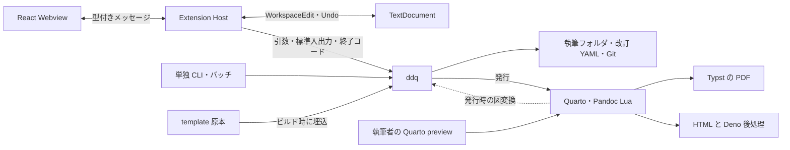

# ddq-template アーキテクチャレビューとリファクタリング計画

2026-11-22 作成。対象は `ramsesyok/ddq-template` のローカル `main`、`17ed32e79bdf8eb71969b1f027088eb6868baa00`。調査開始時の作業ツリーはクリーンで、ローカルの `origin/main` も同じコミットだった。`template/VERSION` と拡張は **3.1.0-pre1**。同じ版名のリリースタグは `2742644` を指し、その後 #141 で新規作成の雛形・テスト・マニュアルが変わっている。本書の基準は HEAD、既存配布物の実測には版名も明記する。

**承認範囲は Phase 1（現状分析）と Phase 2（計画）まで。** 以下の作業項目はすべて未着手。実装・配布物の変更・設計資料の移動は計画承認後に行う。

## 1. 推奨する構成とその理由

| 判断 | 推奨 | 根拠 |
|---|---|---|
| Rust と拡張の分担 | 文書全体の解析・改訂差分・発行は Rust、編集中の文書・対話・Undo は Extension Host に置く | CLI は Git の過去版やファイルを読める。未保存バッファ・選択・Undo の正本は VS Code の `TextDocument` にある。表の局所編集もこの境界に合う |
| CLI 中心を維持するか | 維持する。既存のサブプロセス契約を先に試験で固定する | 同じ exe が ZIP 単独利用と VSIX 内の発行を担い、Lua からも呼ばれる。常駐サーバーや新たな SDK を配る必要はない |
| 旧拡張統合の残課題 | 単一の拡張・二つの Webview バンドルを維持し、実行管理とパネルの寿命を整理する | 登録入口は既に薄い。作成・追加が発行 UI の内部を借用し、改訂処理は別経路で起動・書き込みを行う。画面を統合する利益は小さい |
| 文書生成の配置 | 原本を `template/` に集約した現構成を維持し、章順と形式間の意味の一致を試験する | 素の Quarto プレビュー、Pandoc AST、最終ページを知る Typst、複数 HTML を見渡せる後処理には、それぞれ必要な情報がある。既定の雛形で既に章の取りこぼしがある |
| CI・リリース | Windows で同一コミットから作った exe を実ホスト・同梱版・ZIP の検証に引き渡す。検査用 VSIX と配布用 VSIX の用途を明記する | 現在は二つの workflow で release ビルドし、通常 VSIX と win32-x64 VSIX を別々に作る。ZIP まで通した配布候補を検査するジョブはない |
| 資料 | 利用手順の入口を `docs/manual/`、保守の入口を `docs/README.md` とし、仕様・設計理由・時点付き検証記録を相互参照にする | 統合前の実装仕様や移行時の実測は、現行のファイル名やテスト結果として流用すると誤読する。原記録には当時の版と意味がある |

改善台帳は **17項目（High 7、Medium 9、Low 1）**。既存サンプルの版間比較は141項目すべて一致したが、新規雛形には第2〜7章の取りこぼしがある。最初にこの差を契約試験で固定し、版の誤判定による降格案内、改訂データの往復、単独で配る VSIX の表示と失敗時の配布物保護を優先する。

改善後も主な依存方向は次のとおり。変更を集中させる箇所は Host の実行管理、CLI の文書走査、言語境界の契約試験、配布候補の検査である。

## 2. 現行の責務と依存関係

| 層・入口 | 入力・出力と責務 | 維持する境界 |
|---|---|---|
| `cli/src/main.rs`、`commands/` | clap が引数を解釈し、`init/add/update/setup/pdf/html/diagrams/plantuml/tag/rev/release` を振り分ける。非表示の `mermaid` と `identity` はフィルタ用。フォルダ解決は `writing_folder.rs` | CLI 単体で作成・発行・改訂できる。`release` のみ保守者のリポジトリと npm パッケージングを知る |
| `cli/src/doc/` | `project` が章・付録・include を展開し、`units` と `labels` が見出し・図表・挿入位置を決める。`gitsrc` が Git の旧版を供給し、`diff`・`revfile` が改訂差分・YAML を扱う | タグ候補、文書順、Git 比較を拡張に再実装しない。`ddq tag apply` は CLI のディスク編集、拡張のラベル確定はバッファへの `WorkspaceEdit` |
| `cli/build.rs`、`assets.rs`、`commands/{init,add,update,setup}.rs` | 版は `template/VERSION` から埋め込む（Cargo の `0.0.0` は非公開クレートの値）。原本は一か所。雛形は新規作成時、機構5本と `.template-version` は明示更新時、PDF 側4本は setup 時に展開する | 5本は Lua・CSS・HTML 後処理・Mermaid/PlantUML 設定。PDF 側は `lib.typ`・二つの partial・`_quarto-publish.yml`。既存原稿・`_quarto.yml` の所有者は利用者 |
| `commands/{pdf,html,diagrams}.rs`、`quarto.rs`、`mermaid/`、`plantuml/`、`job.rs` | 機構版・内容を検査し、Mermaid の先行描画と PlantUML セッションを管理する。PDF は setup → publish profile → PDF を取り出し、HTML は `MERMAID_SVG=1` で配布用 HTML を生成。静的図は `diagrams` が変換する | Quarto を引数配列で起動し、`DDQ_BIN` に自分の絶対パスを渡す。ブラウザ／内蔵 merman、設定済みサーバー／ローカル Java の選択、Windows の子孫プロセス解放を保つ |
| `template/` | `design-doc.lua` が図・表・IPO・参照の AST を整形。Typst partial が Quarto の値と様式を接続し、`lib.typ` が紙面・章節に沿う番号・改ページ・分割表通番を決める。`postprocess-html.js` は Quarto 同梱 Deno 上で HTML 群を読み、番号を収集してキャプションと文書間参照を補正する | 配布 HTML は SVG、素のプレビューはクライアント描画も使う。プレビューに ddq・Node/npm の常駐を要求しない。PDF と HTML は番号・参照先を合わせ、改ページ・外枠・横向きは PDF 固有 |
| `extensions/ddq-template/src/extension.ts`、`ddq/`、`build.ts`、`folders.ts` | 機能ごとの activate、設定→同梱→PATH の解決、JSON 取得と進捗ストリーム、フォルダ検出、通知・ステータスバー・右クリックを担当。Quarto は存在確認と子の PATH 設定 | `execFile` と `spawn` の用途を維持。発行・init/add は起動時点の設定を読み、フォルダ・ワークスペース変更は watcher がメニューへ反映する |
| `activateRevision.ts`、`revision/`、`tagging/`、`tableEditor/` | ラベル一覧と改訂 Editor は同じ revision 用 React バンドル。改訂履歴は YAML の Custom Text Editor、表編集はパネルで TableModel と形式別 parser/serializer を使う。Host が範囲・文書変更と書き戻しを担当する | モデル・変換は VS Code から独立して試験できる。Webview はローカル資産、nonce と `default-src 'none'`。拡張は Workspace Trust を要求する |
| `docs/`、`examples/`、`migration/`、`.github/workflows/` | manual は配布、design・実装仕様書は保守用、presentation は revealjs。examples の2文書は回帰入力。migration は既存文書移行用の Python ツールとその資料。CI は Rust、同梱 JS、拡張、実ホスト、VSIX を検査する | migration・紹介スライドは ddq の発行時依存に含まれない。CLI の単独配布は `quarto-template-<版>.zip`、拡張は隣の `ddq-template-win32-x64-<版>.vsix` |

コードから確認する場合は、引数、埋込資産、拡張の公開 ID、配布の組立を次の入口から辿れる。[CLI の定義](../cli/src/main.rs)・[埋込資産](../cli/src/assets.rs)・[拡張の manifest](../extensions/ddq-template/package.json)・[release コマンド](../cli/src/commands/release.rs)

### 固定する外部契約

- **プロセス**　コマンド・サブコマンド・省略時の `docs`、引数順、排他オプション、`--no-render`、`--all`、`--no-build` 等は `cli/src/main.rs` の clap 定義を基準に旧 exe と比較する。成功 0、一般失敗 1、clap の使用誤り 2、機構不一致 3 を区別する。例として `tag apply` のモード未指定は現在 1。進捗とエラーの出力先、HTML の `OK:` 行、PDF の `OK ->`、図がないときの `警告:`、`rev diff --write` の結果行、JSON モードの stdout に人向け文を混ぜないことを固定する。
- **データ**　`tag list --json` の `folder/order/items/warnings`、文字単位の `col`、1始まりの行、任意の `original` と照合、`rev next/diff --json`、`rev-*.yml` と `history.qmd`、タグ名・Git の旧版取得を対象にする。未対応の古い CLI は一覧を表示でき、照合行のない書き戻しは拒否する。日本語・結合文字・サロゲートペア・BOM・CRLF を含む原稿を用意する。
- **設定・環境**　`DDQ_BIN`、`MERMAID_SVG`、`EXECUTABLE_BROWSER`、`DDQ_MERMAID_ENGINE`、`DDQ_DIAGRAM_CACHE`、`DDQ_BROWSER_TIMEOUT` を維持する。PlantUML のサーバー指定順は `DDQ_PLANTUML_SERVER` → `PLANTUML_SERVER` → 原稿側の `plantuml-server`、jar は `DDQ_PLANTUML_JAR` → exe 隣 → `PLANTUML_JAR`。Java は `DDQ_JAVA`・`JAVA_HOME`・PATH・Windows の探索先、起動待ちは `DDQ_PLANTUML_STARTUP_TIMEOUT`。ビルド時の `DDQ_VERSION`、試験用の `DDQ_E2E` と区別する。Windows の ANSI コードページ・パス長診断、空白と日本語パス、バッチ指定の拒否、別プロセスへの引数境界を維持する。
- **VS Code**　publisher/name は `ramsesyok.ddq-template`。公開 ID は `ddqTemplate.` の `init/add/pdf/html/diagrams/tags/newRevision/openTableEditor` の8件、設定は `ddqTemplate.ddqPath` と `ddqTemplate.quartoPath`。改訂 Editor は `ddqTemplate.revisionEditor`、selector は `**/revisions/rev-*.yml`。manifest の `when`、空ワークスペースの導線、進捗・キャンセル・明示 update 後の再実行、Undo、旧二拡張の検出と本人が選んだ場合のアンインストールを維持する。`internal.*` は試験入口として追跡する。
- **出力と更新**　同一環境で章・節・付録、図・表・コード・数式・リスト参照、結合・分割表・IPO の意味を比較する。既存の原稿を移行せずにビルドできること、PDF→HTML の順、冪等な HTML 後処理、執筆フォルダの明示更新、ZIP の UTF-8 名と VSIX の対象 OS/CPU を受入条件にする。

## 3. 資料の有効性と整理先

一冊に複数の性格があるため、判定は章・記述単位とする。利用者の記述、コード、実測が衝突した箇所は「判断待ち」として残す。

| 資料・箇所 | 判定と照合結果 | Phase 5 の扱い |
|---|---|---|
| `README.md`、`docs/manual/`、拡張 `README.md`、`AGENT-GUIDE.md` | 現行利用仕様・入口・派生要約。manual 17章の資料対応、18章の2資産と `release.rs` が対応。一方18章 `06-release.qmd` の「jar が無い」失敗例は 3.0.0 で同梱終了した変更と矛盾し、途中失敗時の保護にも条件がある | 操作手順は manual に一本化。派生要約はリンクと配布時に必要な最小例に限定。版番号・手順・失敗保証は実配布検査と合わせて更新 |
| `docs/design/`、`cli/DESIGN.md` | 有効な設計判断は型組み・出力経路、§3.3 配置、§6 フィルタ契約、§13 PlantUML、§14–15 タグ・改訂。CLI §8 は構成「案」、§12.5 は 2.0.0 と旧 bat の比較記録。§2・§11 の図ごとの起動・バッチ化保留と §5.5／`mermaid/prerender.rs` の現行バッチ処理が食い違う。§14.5 の編集例では現在必須の照合行 `original` が分からない | 現行の責務・契約を本文に置き、移行計測と旧案は対象版を付けて参照する。`docs/design/chapters/03-pipeline/01-overview.qmd` の「FORMAT 分岐は1か所」も Lua の実分岐と突き合わせる |
| `docs/cli-impl/` と `analysis/` | コミット・検証条件付きの実装記録。README 基準は `281d62f`・2.4系、本文には後日の更新もある。過去の成功件数・ソースハッシュは HEAD の測定値として使えない | 変更した節に基準コミット・検証日・現行ソースを付ける。過去ログは元の版のまま参照 |
| `docs/ddq-template-impl/`、`parts/{revision,table-editor}/` | 共通基盤は統合後の解説。README が明記するとおり parts と解析根拠には旧拡張名・ID・パスを保持。旧名を現行 manifest に戻す根拠にはならない | 現行の入口・コマンド・パス対応表から案内し、変更した箇所のみ現行記述へ。過去のハッシュと本文の由来を保持 |
| `docs/ddq-template-study.md`、`docs/revision-study.md`、`cli/plantuml-study.md` | 決定と検討経緯。単一 VSIX、明示更新、ローカル配布、Git タグ単位の改訂、PlantUML のサーバー方式は実装と整合。統合検討 Q6 の段階計画・旧ディレクトリ図は現在の機能一覧と異なる | 有効な判断を「理由・採用版・参照先」で索引化。検討段階の案・未採用案を履歴として残す |
| `extensions/ddq-template/{DEVELOPMENT.md,AGENTS.md,tableEditor-requirements.md,CHANGELOG.md}` | 開発・試験手順、表の互換規則、版別の更新記録。要件書冒頭の `AUTHORING.md` は現ツリーに存在せず、一部が陳腐化。表の merge-cols・改行・範囲保存の制約は現行試験と照合できる | 手順は DEVELOPMENT、現行記法は manual 9章、実装制約は AGENTS に相互参照。要件書は根拠のある節を残す |
| `docs/test-coverage-review.md`、`docs/ddq-template-pr122-final-response.md`、`docs/design/analysis/table-pagination.md` | それぞれ `bf1e70e`、PR #122、分割表修正時点の記録。fake Host の当時の CI 説明は現 workflow と異なる。新規雛形・pre 版の欠落は歴史的な高カバレッジから判断できない | 当時の結果は保存し、索引に対象版を付ける。現行 CI の正は workflow と本書の測定条件 |
| `docs/presentation/`、`examples/README.md`、`migration/README.md`・`migration/docs/` | 紹介・実例・移行ツール固有の仕様。一般利用の仕様と適用先が異なる | 対象と読者を索引に載せる。紹介スライド・旧移行ツールの全面改稿は今回の対象外 |

**実装と矛盾する手順の例。** `cli/DESIGN.md` §7.5 の例は `cd cli` 後にそのまま release するが、`commands/release.rs::run` はカレントに `template/VERSION` と `docs/manual/_quarto.yml` を要求する。manual 18章のリポジトリ直下での実行が一致する。`docs/revision-study.md` §5.8 の js-yaml 案に対し、実装は `revision/revfile.ts` の限定コーデックである。いずれも古い説明を満たすために依存や CLI の受理範囲を増やす理由にはならない。

## 4. 問題点と改善台帳

パスはリポジトリ基準。`E/` は `extensions/ddq-template/src/`、行番号は上記 HEAD に対応する。**実測**はこの調査で観測した結果、**静的**はコードを追った結果、**リスク**は発生条件を推定したものを示す。優先度 High は既存原稿・発行物・配布に影響、Medium は障害の局所化・保守負担の軽減、Low は効果を確認してから進める整理。ID は以後の作業・検証記録のキーとする。

### High

| ID・種別 | 問題と根拠 | 提案・期待効果 | 互換性・完了条件 | 進捗・検証記録 |
|---|---|---|---|---|
| QA-01　契約試験 | `E/ddq/run.ts:76` の `JSON.parse` は型アサーション。`E/build.ts::htmlIndexOf/warningOf`、`E/activateRevision.ts` は JSON・文字列・行番号の単位に依存。個別の golden、実 Host は既にある | 既存の Host golden、Rust CLI の実行試験を流用し、同じ最小原稿・期待値で出口から消費側まで検査。欠落・型違いは書き込み前に診断し、追加の未知フィールドと旧版の省略形は許容する | 現行/旧版の JSON・stdout/stderr・exit・明示 update・Undo を固定。fixture の更新理由と実 exe の版を記録。成功・失敗の観測を先に追加し、既存期待値を上書きしない | 未着手 |
| GEN-01　不具合・判断待ち | **実測**　`template/scaffold/content/_quarto.yml:44–49` は第2〜7章に行末コメントを持つ。`cli/src/doc/project.rs:220,253` と `template/postprocess-html.js:57` の行パーサがその6章を落とす。新規作成後、Quarto は表紙を含む8 HTML を生成、tag の `order` は第1章までの6ファイル、章04の `tbl-user` のキャプションは番号なし。引用した空白付き章名も Quarto の入力に含まれ、Rust の一覧では警告なしに欠落。JS と Rust は入れ子の part への対応も異なる | まず実雛形を独立 fixture に加え、コメントを前行に移すだけで解消する範囲を測る。既存文書にも効く本修正として、引用内の `#`、空白、part、付録を含む章順を同じ原稿で両実装に検証する。Quarto が既に解決した章情報を HTML 側で使えるか確認。CLI 単独の tag/rev は Quarto 起動を必要としない設計を保つ | 文書順・ラベル候補・改訂差分・HTML の番号と参照が変わり得る。対象構文と旧文書への適用を承認後に実装。新規/既存/過去 Git 版、増分 HTML と再実行で章・付録が一致し、従来 fixture の出力が一致すること | 未着手 |
| EXT-01　不具合・判断待ち | **実測**　`E/ddq/version.ts:13,32` は数値化できない `pre4` 等を 0 とする。`3.0.0` 対 `3.0.0-pre4`、`3.0.0-pre4` 対 `3.0.0-pre1` がいずれも `modified`。`E/build.ts::offerUpdate` はこのとき更新を提示し、版を取得できない場合も `folder-older` と扱う | 出荷済み版名と既存の短縮数値版を表にし、降格を案内しない比較と不明時の UI を決める。比較器と更新判断を純粋関数として試験する | 通知と「update を実行」の有無が変わる。正式版/pre1/pre4、将来の pre10、旧 `2.4`、同版内容差、欠落・不正値を両方向で検証。利用者が明示的に呼ぶ CLI `update` は別契約 | 未着手 |
| DATA-01　不具合・判断待ち | **実測・静的**　`E/revision/revfile.ts::unquote/quote` は引用が必要な `path: C:\docs` を直列化し読み戻すと逆斜線が増える。Rust の `cli/src/doc/revfile.rs:283,337` にも同じ非対称がある。Host は編集時に YAML を再生成する | `rev-B.golden.yml` に加えて手書き／既生成の YAML を Rust→TS、TS→Rust、二度目の保存で比較。限定形式とエスケープの契約を決める。未保存の YAML を編集する Host の役割は保つ | 古い二重エスケープをどう読むかは利用者データの判断。コメント・未知キーの扱い、空メモ、複数行、日本語・Windows パスを明記し、自動一括移行は別承認。既存の正常な改訂内容が同じであること | 未着手 |
| IO-01　耐障害性／別途 BOM 方針 | **静的**　`commands/tag.rs:54–81`、`commands/rev.rs:245,293` は原稿・メモ・履歴を直接上書きする。複数ファイル途中失敗、一覧後の外部更新、Windows で開かれたファイルを考慮する必要がある。**実測**　BOM+CRLF 原稿への `tag apply --all` はラベルを付与し CRLF を保ち、BOM を落とした | 書き込み対象と元行の事前照合、同一ディレクトリの一時ファイルからの単一ファイル置換を tag、改訂の順に導入。既存 `tempfile` を使い、中断後も原稿が途中バイト列にならないようにする | 同時変更・読み取り専用・ロック・再試行・改行・末尾改行・`--dry-run` を試験。複数ファイルの結果を利用者が特定できること。BOM 保持への変更と競合時の終了・メッセージ変更は明示承認 | 未着手 |
| REL-01　配布内容 | **実測**　既存 3.1.0-pre1 と HEAD から作った対象指定 VSIX の各13エントリに拡張自身の `LICENSE.txt` はあるが、ルートの第三者表示ファイルがない。ZIP は `commands/release.rs:205` が `THIRD-PARTY-NOTICES.md` をコピー。VSIX 単独の利用者も同じ exe と React を受け取る | 既存の生成済み通知を対象指定 VSIX に同梱し、実アーカイブから読めることを検査。`cli/tools/third_party.py::INPUTS` の5入力と zip/VSIX の表示が揃うようにする | 配布物にファイルが増える。両アーカイブの表示・ライセンス本文・同梱 exe・版・target を照合。jar は利用者が用意し、同梱一覧に加えない | 未着手 |
| REL-02　配布の耐障害性 | **実測**　`cli/src/commands/release.rs:119–147` は stage、ZIP、VSIX の順に確定する。一時コピーで旧 ZIP を Windows の排他読取で開いて `release --no-build` を再実行すると、exit 1（os error 32）。旧 ZIP のハッシュは同じだが、旧 stage に置いた識別ファイルは消え、展開フォルダだけ交換されていた | 同一出力先への並行実行を制御し、実行ごとの作業場所で全資産を準備・検査してから公開する。固定 `.building` の共有を避け、現行名を維持する場合の退避・復元手順を設計する | 複数ファイルの一括 rename は前提にできない。保証する範囲（失敗後の旧一式復元／読み手から見た切替）を決定。VSIX コピー失敗、ZIP 失敗、rename 失敗、並行・再実行ごとに旧資産のハッシュを検査 | 未着手 |

### Medium と Low

| ID・優先度・種別 | 問題と根拠 | 提案・期待効果 | 互換性・完了条件 | 進捗・検証記録 |
|---|---|---|---|---|
| CLI-01　Medium・内部整理 | `cli/src/doc/project.rs::logical` が順序取得後に再展開し、`doc/mod.rs::scan_folder` は再読込と全行マップの clone を行う | 既存のファイル／Git の読み取り境界を使い、文書順・行・警告を同じ走査で得る。まず全行 clone を除く。大文書と Git 参照時の I/O を減らす | QA-01 後。読込回数・大文書の実行時間を測り、重複 include、欠落警告、章基準の相対パス、ラベル・編集位置、diff の順序が一致。GEN-01 の解釈変更とは別差分 | 未着手 |
| IO-02　Medium・作成と更新の再試行 | **静的**　`cli/src/assets.rs::write_dir_if_absent/write_if_absent` は存在確認と書込みが別で、並行作成時に既存ファイル保護を保証できない。`commands/update.rs::run` は5本の機構と版マーカーを書いた後にキャッシュを消す。最後の削除失敗後に再実行すると版が同じに見える | 既存原稿を作る操作は排他的な新規作成を使い、既存扱いの表示は維持する。機構の置換・キャッシュ更新・版マーカーの確定順を見直し、失敗後の再実行で完了できるようにする。既存の `ensure_current` による内容検査も残す | IO-01 の単一ファイル置換を使える箇所だけ再利用。二つの init/add の競合、途中でファイルが開かれた update、同版修復、版が変わる update を試す。利用者の原稿と設定を保ち、同版修復で全図を無条件に消さない | 未着手 |
| EXT-02　Medium・内部整理 | `E/init.ts`、`E/add.ts` が `E/build.ts` の settings・出力・進捗・エラー表示に依存。`E/ddq/run.ts:46,105` は JSON とストリームで異なる失敗契約を持ち、ストリームは全出力を保持。`deactivateBuild` の追跡は後者のみ | 既存 `ddq/` と activation 内に設定解決・実行寿命を寄せ、機能モジュールは発行 UI を import せず同じ起動口を使う。JSON／長時間実行の2方式は残す。通知に要る結果行と出力チャネルへの逐次転送を分ける | QA-01 後。引数・cwd・PATH、UTF-8 チャンク境界、exit 3、ENOENT、別フォルダ並行、取消時の Windows 子孫終了、deactivate 後の出力を検証。改訂書込みにも排他を広げる場合は後述の判断が必要 | 未着手 |
| EXT-03　Medium・状態管理 | `E/folders.ts:133–172` の複数の非同期走査が同じ context を更新。`E/tableEditor/activateTableEditor.ts:26,61,166,200` が単一 session を持ち、確認ダイアログ中にパネルの対象が変わり得る。`E/revision/provider.ts:63,195` はドキュメント変更ごとに状態取得し、書き戻し結果も要確認 | 既存のタグ一覧の世代番号と文書 version チェックを手本に、操作開始時の文書・パネルと完了時を照合。watcher・timer・panel・出力チャネルの所有者を activation/各 session に限定。タグ状態取得をメモ入力ごとに繰り返す必要を検討 | 現行のパネル数・再表示・Undo は維持。応答順逆転、close→reopen、未保存編集、設定変更、多ルート追加・削除、deactivate 後の通知を fake と実 Host で試す。失敗の UI 変更は別に明記 | 未着手 |
| GEN-02　Medium・契約試験 | 三つの重複がある。① `mermaid/prerender.rs::cache_key/fresh` ↔ Lua の `cache_key/mermaid_env_matches`。② `plantuml/mod.rs` と Lua の `puml_source/puml_env_matches`。③ `E/tableEditor/formats/mergeCols/simulateMergeCols.ts` と Lua の `merge_body` | 同一入力と期待 SVG 名・設定の連結結果・表セル範囲を用意し、①〜③を一組ずつ検証。PDF/HTML の番号と参照は機構 golden で比較。実行時に言語を結ぶとプレビュー用 exe や各打鍵でのプロセスが必要になるため、境界に試験データを共有する | 出力を変えない。CRLF、フォント/エンジン、キャッシュ keep/更新、設定の有無、merge-cols の左→右順序と分割済み表、付録を含める。既存のキーや図名の変更にはキャッシュ移行判断が必要 | 未着手 |
| REL-03　Medium・入力検査 | `commands/release.rs:74,84,267` はリポジトリの VERSION の存在を見て、拡張の版は埋込版と比較する。作業ツリーの VERSION の文字列はこの段階で比較しない。同一版名で雛形が変わった実例もある | 重い処理の前にリポジトリ VERSION・exe 版・manifest・lock のルート版を照合。CI は同じ checkout のビルドを使い、配布検証の記録にコミットと exe の SHA-256 を残す | 正常時の版規則とファイル名を保持。古い exe、新旧 manifest、同版で異なる exe の VSIX、`--no-build` で確認。既存のバイト照合は残す。事前拒否する条件は保守者が承認 | 未着手 |
| CI-01　Medium・配布検証 | `.github/workflows/extension.yml:79,107,119,179` は実装では real Host 必須、最後は Linux で通常 VSIX。`ci.yml:96–124` は PR 以外で win32-x64 を smoke。両 workflow が別々に CLI をビルド。起動対象のパスに manual、examples/plantuml、ルートの通知変更等が含まれない。release 試験の一部は `tests/fixtures/release/pack.js` による模擬梱包 | Windows 配布候補の作成者を一つにし、同一 workflow の artifact または再利用可能なジョブで受け渡す。PR は高速試験・real Host、main/手動は実リリース候補 ZIP＋対象 VSIX の検査。Quarto 固定、Cargo は `--locked`、jar は `cli/vendor/README.md` の版と SHA-256 を照合 | Node 20/22、Linux の必須 Pandoc、Windows golden の許容差、audit、Mermaid の lock からの再生成照合を保つ。公開・タグ作成は保守者の操作。通常 VSIX の artifact を統廃合する場合は利用者を確認 | 未着手 |
| CI-02　Medium・検査対象 | `extensions/ddq-template/package.json:162,167–178` では React/React DOM は devDependencies、必須検査は `npm audit --omit=dev`。一方 `cli/tools/third_party.py::EXTENSION_BUNDLED` は React/React DOM/scheduler を実配布対象に挙げる。`extension.yml:144,148` は全依存の監査結果を参考扱いにする | 既存の lock・配布対象一覧を照合し、Webview のバンドルに実際に入る依存を必須検査の対象にする。開発ツールの扱いは別に決める | 外部契約への影響なし。既知の指摘を含む模擬の監査結果で、配布対象が失敗、開発用だけの指摘が承認済みの扱いになることを確認。本レビューでは新規の脆弱性有無は判定していない | 未着手 |
| DOC-01　Medium・資料整理 | §3 の旧パス・失敗保証・配布手順の混在。`docs/manual/chapters/11-publisher-env/05-offline.qmd` の閉域持込表には、LAN サーバーなしで PlantUML を発行する場合の Java・jar がない | `docs/README.md` の索引に用途・対象版・検証日・後継先を追記。利用条件と手順は manual、理由は design、版付き解析は各 impl に一度だけ詳述。アーカイブ候補は索引から元パスで辿れるようにする | 各領域の変更完了後、リンク・旧 ID の注記・配布用 manual の PDF/HTML を確認。旧資料削除は個別承認。AGENTS 追加は実装で必要なルールが生じた場合のみ | 未着手 |
| EXT-04　Low・重複整理 | `E/revision/provider.ts` の Webview HTML と `E/tableEditor/activateTableEditor.ts:209` が nonce・CSP・バンドル URI の組立を重複。表は `localResourceRoots` を対象資産に限定する | 重複している HTML 生成・資産範囲だけ共有し、画面のメッセージ型・TableModel・改訂モデルは各機能に残す。Host 受信時の識別子と書込対象を検証する | 2バンドルの配信・起動・メッセージ・CSP・旧データを実 Host と `check:offline` で確認。全画面共通の状態ストアは導入しない | 未着手 |

## 5. 実装順序と判断の分岐

| 段階 | 着手条件・作業 | 完了の判定 |
|---|---|---|
| Phase 3a　契約の固定 | 計画承認 → QA-01。GEN-01・EXT-01・DATA-01・IO-01 の現象を修正前に再現し、不具合として扱う対象を選ぶ | 現行の成功と欠落を別の例で説明でき、試験が該当の変更を検出する |
| Phase 3b　互換性を保つ整理 | QA-01 後に CLI-01、EXT-02、GEN-02 を独立に実装。EXT-03 → EXT-04 の順。1項目ずつ関連試験と実 Host/サンプルを実行 | 同じ入力で CLI 出力・原稿・文書上の番号が一致。計測効果や依存方向の改善が説明できない抽出は見送る |
| Phase 3c　個別承認分 | GEN-01、EXT-01、DATA-01、IO-01 の仕様が決まったものから個別に実装。IO-02 の再試行検証は IO-01 の置換方式決定後に行う。章認識と走査最適化、YAML 互換修正と書込み方式は別変更にする | 対象の旧データと新規データを比較し、利用者に見える差、移行方法、戻す方法を記録 |
| Phase 3d　配布 | REL-01、REL-03、REL-02 を各々検証してから CI-01 に接続。CI-02 は配布対象一覧が定まれば並行して進められる。公開前の検査まではローカルでも再現できる形にする | 検査を通した exe のハッシュが ZIP と VSIX で同じ。失敗時の旧資産保証・正常時の構成が一致 |
| Phase 4　統合検証 | §6 の測定条件で最新 HEAD・直前配布版を別々に試す。古い設計書・実 Host・同梱 exe・スタンドアロン ZIP・実サンプルを通す | 期待外の差を解消するか、承認された差として文書名・箇所・影響を記録。未実施は理由と再試験条件を明示 |
| Phase 5／6　資料と完了レビュー | DOC-01。各 ID の実装差分・試験結果・外部契約を照合し、残債と次回判断を記録 | 変更した source/manifest/workflow と索引・配布 manual が整合。章番号・出力経路・配布資産の変更を利用者が追跡できる |

実装時は **ID｜状態（未着手／実装中／検証済／保留）｜対象コミットまたは差分｜実行コマンド・対象環境｜結果／残件** をこの台帳に追記する。初期状態は全項目「未着手」。下記の基準結果は計画項目実装後の合格とは別の記録である。

## 6. 変更前の検証基準

Windows x64、Rust/Cargo 1.98.1、Node 24.18.0、npm 11.13.0、VS Code 1.147.0、Quarto 1.9.38（同梱 Pandoc 3.8.3・Typst 0.14.2）、Java 17.0.2、Git 2.44.0.windows.1、Python 3.12。CI の Node 20/22 と今回のローカル Node は異なる。調査対象のソース・lock・golden は変更していない。

初期 checkout には拡張の `node_modules` と PlantUML jar がなく、直接の typecheck／Vitest は tsc／vitest 不在で終了1だった。同じローカルコミットを持つ別 checkout の既存資産を利用し、拡張は lock の SHA-256（`de06d3a6…`）と既存403パッケージのインストール記録にある版・integrity を照合して作業コピーで測定した。PlantUML は `cli/vendor/README.md` の SHA-256 `3629c9cd017c7f73e6450396eea0040216c7e1eef8473ce33cc1aad469dab2f9` に一致する MIT jar を指定。依存の追加・更新や外部からの取得は行っていない。

| 対象 | コマンド・条件 | 初期結果と検証範囲 |
|---|---|---|
| CLI ビルド | `cli/` で `cargo fmt --check`、`cargo clippy --locked --offline --all-targets -- -D warnings`、`cargo build --locked --offline`、`cargo build --release --locked --offline` | 全て成功。debug と release を当該コミットから生成。キャッシュの hard-link に関する警告あり |
| Rust 全件 | Git 管理外の一時ディレクトリで `DDQ_E2E=1`、検証済み `DDQ_PLANTUML_JAR`、npm オフラインを設定し、`cargo test --locked --offline --no-fail-fast -- --test-threads=1 --nocapture` | **168件成功・失敗0・ignored 0、exit 0**。unit 89、commands 10、e2e 4、faults 8、golden 2、mechanism 2、plantuml 4、release 11、rev 13、rev_ops 4、table_pagination 2、tag 18、third_party 1。ASCII と日本語パスでの実 PDF/HTML、ブラウザ描画、子プロセスの障害時解放、ローカル Java サーバーを含む |
| CLI 外部契約 | 実 exe の `--version`、`init --no-render`、`tag list --json`、無効引数、モード未指定 `tag apply`、版不一致の `setup` | 版 `3.1.0-pre1`、一覧の4つのトップレベルキー、exit 0/2/1/3 を確認。不一致時は stdout 空・stderr に診断。初期雛形に章の欠落があるため、exit 0 だけでは網羅を意味しない |
| 型・Webview・表の解釈 | 拡張で `npm run typecheck`、Quarto 同梱 Pandoc を PATH に置き `REQUIRE_PANDOC=1 npm test`、`npm run build`、`npm run check:offline` | 二つの tsconfig が成功。Vitest **38ファイル・376件成功**。モデル／serializer、実 Pandoc、jsdom 画面、fake VS Code の対話・メニュー条件を含む。Host/JS/CSS 計5ファイルと CSP の静的検査も成功 |
| 実 Extension Host | インストール済み Code を明示し、`DDQ_HOST_REAL=1` と `DDQ_BIN=<HEAD debug exe>` で `npm run test:host`。試験プロセスの継承 Git 設定を `GIT_CONFIG_COUNT=0` にして再試験 | **25項目成功**。タグ書戻し・Undo・旧 CLI 形式拒否、改訂メモ→表→Git 差分、表パネル、exit 3、排他、実 PDF/HTML、日本語名の init/add。fake CLI の成否と区別 |
| 配布 VSIX からの起動 | 同じ HEAD の debug exe を作業コピーの `bin/win32-x64/ddq.exe` に置き `npm run package:win32-x64` → `npm run test:smoke`。展開した VSIX を実 Code で起動し、PATH の ddq を除く | **3項目成功**。同梱 exe を実際に選択、init、HTML 生成。開発フォルダの `out/` を読み込む Host 試験と区別 |
| 拡張の更新 | 一時 `--user-data-dir` と `--extensions-dir` のみに `code --install-extension <VSIX> --force`。保管版 3.0.0 → HEAD 3.1.0-pre1 の順 | `--list-extensions --show-versions` で同一 ID の更新を確認し、ddq/quarto 設定を置いた `settings.json` のハッシュも一致。旧二拡張の同居・利用者による解除は別の試験範囲 |
| 出力の機構 | Rust の `tests/mechanism.rs` と `table_pagination.rs`、実 Quarto/Typst の fixture | 各2件成功。前者は HTML／PDF 中間表現の期待値、後者は分割表のページごとの本文・通番を検査。雛形の章リストを fixture に差し替えるので GEN-01 は検出できない |
| サンプルの版間比較 | `examples/docs` のコピーに対し保管版 3.1.0-pre1 と HEAD debug を順に `update`。各々 `python cli/tools/regress.py capture <baselineまたはcandidate> docs --builder ddq --ddq <exe>` → `compare docs`。両側で内蔵 merman を指定 | **141比較一致・差分0**。機構5本、中間 Typst、51ページの画像、PDF 本文、HTML、SVG を照合。初回は直接の `quarto typst compile` が fontawesome を解決できず終了1。再試験は `TYPST_PACKAGE_PATH` を Quarto の `share/formats/typst/packages` に設定して完走 |
| PlantUML サンプル | `examples/plantuml` のコピーで実 exe の `update → diagrams → pdf → html`。検証済み jar で localhost の Java サーバーを使用。生成後 `quarto run postprocess-html.js _book` | 各 exit 0。PDF 42ページ、HTML 13ページ、PlantUML のキャッシュ25図。後処理再実行で図表43・参照69、13 HTML のハッシュは全て不変 |
| 配布用マニュアル | `docs/manual` のコピーで `ddq update` → `ddq pdf` → `ddq html` | 成功。PDF 136ページ、HTML 20ページ、後処理対象は図表64・参照214。実マニュアルを ZIP 梱包試験に使用 |
| 埋込の Mermaid | `cli/tools/mermaid-bundle` の作業コピーで、一致する lock・既存依存を使い `node build.mjs` | 成功。Mermaid 11.16.1、DOMPurify 3.4.18、KaTeX 0.18.10、同梱66パッケージ。`mermaid.min.js` と `bundled.json` はともにリポジトリの原本とバイト一致 |
| HEAD の配布候補一式 | release ビルドの exe を同梱して再度 `npm run package:win32-x64`。生成した実 VSIX と上記 manual を検証用リポジトリに置き、同じ release exe で `ddq release output-release --no-build`。アーカイブを再読込 | 成功。VSIX は win32-x64・13件、ZIP は50件。CRC、ZIP 全ファイルと stage のバイト一致、ガイド・manual・第三者表示を確認。ZIP/VSIX 内の exe は入力と同じ SHA-256 `5d1c99740796e6d2828d7c0a89f85a23d129d33a5e777919c7606a4ef6ee64cb`。VSIX の第三者表示ファイル欠落は REL-01 |
| release 版の両入口 | ZIP から取り出した exe を使い、日本語パスで `init --no-render → pdf → html`。PATH から Node/npm を外し、プロキシの外向き接続先を不通にして、ローカル jar と内蔵 merman を使用。別に、直前に出力した VSIX で実 Code の `npm run test:smoke` を再実行 | ZIP は全コマンド exit 0、PDF と HTML の実ファイルを確認。VSIX も同梱選択・init・HTML の3項目に成功。Code 本体のギャラリー照会には失敗ログが出たが、DDQ のスモークは完走した。プロキシ指定は全通信を遮断する OS レベルの試験とは異なる |
| 既存の配布資産 | ローカルに保管された 3.1.0-pre1 の VSIX と ZIP を個別に開き CRC・manifest・ファイル名を読み、中の exe を別々に取り出して `--version` と日本語パスへの `init --no-render` を実行 | VSIX 13件、ZIP 50件。両 exe の SHA-256 は `d438acdf…` で一致、各コマンド成功。ZIP はガイド・manual・表示を含み、jar と VSIX は含まない。オンライン公開済み資産との同一性は別途照合が必要 |

**今回の未実施範囲。** 実プロジェクトの通常の `ddq release` は `npm ci` を実行するため、依存を入れ直さず、実マニュアル・実 VSIX を作成して `--no-build` からの梱包を検証した。Rust の release fixture が通す通常経路では Quarto と npm を実行するが、拡張の梱包スクリプトは試験用である。通信を要する最新の cargo/npm 監査、Linux・Node 20/22 の CI 再走、実 LAN サーバー、OS レベルで隔離した閉域端末、公開後の再取得、実画面の IME・旧二拡張同居時の手操作は未実施。現在の所見をこれらの合格には数えない。

**再試験の環境条件。** Quarto はサンドボックスの `#!sandbox...` を含む一時パスで入力を解決できず、Windows Job Object の子プロセス終了試験にも環境差が出た。Git 管理下に置いた短い一時パスでは、逆に `commands.rs::init_then_add_then_update_all` の「祖先に版管理の目印がない」条件を満たさず1件失敗した。基準測定には Git 管理外の短い一時パス、通常の Windows 子プロセス権限、検証済みの jar を使用する。製品側の検出規則・試験の期待値は変更していない。

検査内容とスキップ条件はスクリプトでも確認できる。[CLI の文書 E2E](../cli/tests/e2e.rs)・[機構の golden](../cli/tests/mechanism.rs)・[版間比較](../cli/tools/regress.py)・[実 Host](../extensions/ddq-template/tests/host/run.mjs)・[同梱版スモーク](../extensions/ddq-template/tests/host/smoke.mjs)・[CLI の CI](../.github/workflows/ci.yml)・[拡張の CI](../.github/workflows/extension.yml)

### Phase 4 の受入手順

1. **CLI と Host。** CLI 作業ディレクトリは `cli/`、npm は `extensions/ddq-template/`。既存スイートに加え、実 exe の PATH／同梱／設定指定を切り替え、2種類の不一致（新しい文書と同版の内容差）、失敗・取消後の次回実行を確認する。開発用 fake は応答順・旧版欠落・ダイアログ選択の固定に使う。
2. **文書。** 新規雛形、従来の2サンプル、既存改訂 YAML、manual を独立したコピーで処理する。通常例に加え、章リスト末尾コメント、part、引用、付録、相互参照、手動／自動分割、表書戻し→実 Pandoc/Lua の順を試す。図は browser と merman を分け、フォント・Quarto 版・jar・キャッシュ有無を記録する。紙面差は該当ページを抽出し、変更理由を確認してから期待値を更新する。
3. **配布。** Windows x64 の release exe に対し、準備済みのビルド環境でリポジトリ直下から通常の `ddq release` と `--no-build` を試す。`--with-sample` の ZIP、異なる exe の VSIX 拒否、途中失敗／再実行も確認。ZIP では UTF-8 名・manual・通知・CRC・実 exe の init→pdf/html、VSIX は target・版・同梱 exe の SHA-256・通知と実 Host の init→html を確認する。公開後は同じハッシュの ZIP/VSIX を利用環境に持ち出してスモークする。
4. **閉域・UI。** 配布先に Node/npm を入れず、外部通信を遮断した端末で VSIX と ZIP をそれぞれ実行。ローカル Java＋jar、LAN サーバーを明示した環境、PlantUML を使わない環境を区別する。JS 静的検査と localhost での描画で閉域端末の全動作を代替しない。実 Webview の IME・セル結合操作・未保存編集・パネル切替、旧二拡張からの移行導線は人の操作も含めて確認する。

## 7. 承認が必要な判断と残るリスク

| 判断 | 推奨、影響と移行方法 |
|---|---|
| 雛形と既存文書の章順（GEN-01） | 雛形のコメント修正は新規作成分にのみ効く。既存 `_quarto.yml` は自動書換えせず、必要なら行末コメントを前行に移す回避策を案内する。解釈修正時は旧入力を両版で読み、増えたラベル候補・番号・改訂行を一覧にして発行者が差分確認後に採用する |
| プレリリースと未知の版（EXT-01） | 出荷済み `preN` を番号順、正式版をその後とする案を承認対象にする。版が判別できない場合は文書と exe の版を確認する導線を推奨する。既存の短縮数値版・明示 update は維持。導入時は拡張の更新案内と旧 CLI 指定時の表示を告知する |
| 既存の改訂 YAML と原稿バイト（DATA-01・IO-01） | 書き手が意図した逆斜線の数を既存データだけで復元できない場合がある。旧形式の読込例と新しい出力を示し、既存ファイルの一括変換を避け、Git 差分を確認して保存する。BOM・改行の保持、競合時に部分成功を許す単位と終了コードも確認する |
| 排他・失敗保証（EXT-02・REL-02） | 読取り操作を並行可能にし、同じ原稿・改訂・生成物への書込みだけを直列化する案。別ウィンドウや独立 CLI へのプロセス間ロックは操作フローと障害回復が変わるため別途判断。配布先の固定名を読む既存スクリプトを維持し、Windows ロック時に保証できる範囲をテストと文書に明記する |
| 配布契約と試験費用（REL-01・REL-03・CI-01） | 既存通知を VSIX に同梱し、両資産のファイル一覧差をリリースノートに記載。通常 VSIX artifact の利用先と、PR でのフル配布検査の所要時間を確認してジョブ配置を決める。署名・Marketplace 移行・自動公開は今回の改善項目に含めない |
| 設計履歴と旧版互換（DOC-01・EXT-04） | 旧拡張検出、旧 CLI `original` 欠落への対応、`--no-build`、統合前の仕様書は利用実態の証拠が得られるまで保持。移動は参照元と後継リンクを確認し、削除には個別承認を得る |

Phase 3 の開始条件は本計画への承認である。承認時に見送った不具合修正は、他の内部整理と独立して保留できる。
