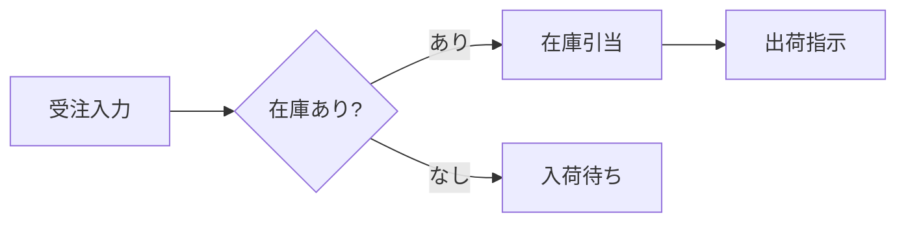
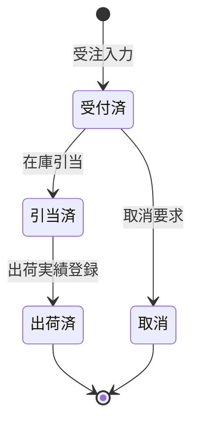

## mermaid 図 {#sec-fig-mermaid}

フローチャート・状態遷移図・シーケンス図などは、` ```mermaid ` のフェンスに文字で
書くとそのまま図になる。原稿の差分としてレビューできる。プレビューでは追加の準備なしに
描かれる。

### 番号とキャプションを付ける

`::: {#fig-…}` で囲み、`:::` の直前の行にキャプションを書く。囲まなければ番号の無い図になる。

````markdown
::: {#fig-order-flow}



受注から出荷指示までの流れ
:::
````

::: {#fig-order-flow}


受注から出荷指示までの流れ
:::

処理の流れを @fig-order-flow に示す。

### 状態遷移図

::: {#fig-order-state}



受注の状態遷移
:::

### 主な図の種類

| 先頭の行          | 図の種類                   |
|-------------------|----------------------------|
| `flowchart TD`    | フローチャート（上から下） |
| `flowchart LR`    | フローチャート（左から右） |
| `stateDiagram-v2` | 状態遷移図                 |
| `sequenceDiagram` | シーケンス図               |
| `erDiagram`       | ER 図                      |
| `gantt`           | ガントチャート             |

- 大きさは指定しなくてよい。本文幅に収まらない図だけ自動で縮小される。
- 横に長い図は文字が小さくなる。横向きページ（@sec-landscape）に置くと本文幅が広がる。
