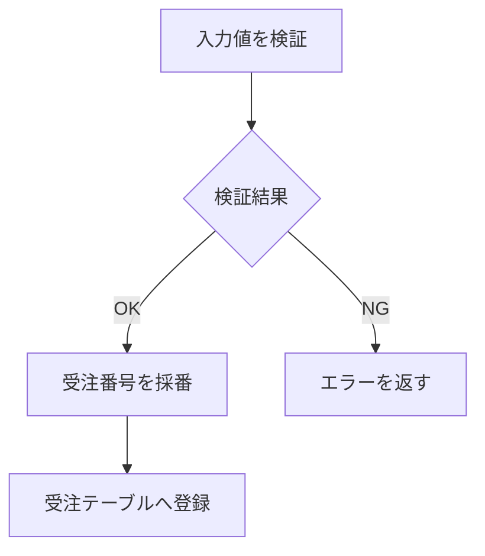

## IPO 図 {#sec-ipo-basic}

`::: {.ipo …}` 〜 `:::` で囲むと、**横向きの定型ページ**（機能名・処理名の欄 ＋
入力／処理／出力の3列）になる。IPO 図は表として採番され、本文中の表と同じ連番に載る。

````markdown
::: {.ipo module="受注管理" caption="受注登録処理" label="tbl-ipo-order"}
## 受注登録

### 入力

- 受注入力画面の入力値
- 顧客マスタ
- 商品マスタ

### 処理



### 出力

- 受注テーブル
- 受注番号（画面へ返す）
:::
````

::: {.ipo module="受注管理" caption="受注登録処理" label="tbl-ipo-order"}
## 受注登録

### 入力

- 受注入力画面の入力値
- 顧客マスタ
- 商品マスタ

### 処理


### 出力

- 受注テーブル
- 受注番号（画面へ返す）
:::

受注登録の内容を @tbl-ipo-order に示す。

::: {.tbl caption="IPO 図の指定項目" label="tbl-ipo-attr" tbl-colwidths="[24,26,50]"}
| 項目               | 指定のしかた                  | 備考                                  |
|--------------------|-------------------------------|---------------------------------------|
| 機能名             | `module=` 属性                | 必須                                  |
| 処理名             | 最初の見出し（`##`）          | 必須                                  |
| キャプション       | `caption=` 属性               | 省略可                                |
| 参照 ID            | `label="tbl-…"` 属性          | 省略可。`tbl-` で始める               |
| 入力・処理・出力欄 | `### 入力` `### 処理` `### 出力` | ふつうの Markdown（箇条書き・mermaid など） |
:::

::: {.callout-warning}
`### 入力` `### 処理` `### 出力` の**前後には空行を置く**。箇条書きの直後に空行なしで
書くと、見出しではなく前の項目の続きとして読まれ、欄が分かれない。この3つ以外の見出しは
書かないこと。機能に複数の処理があるときは、同じ `module=` で処理ごとに IPO 図を並べる。
:::
